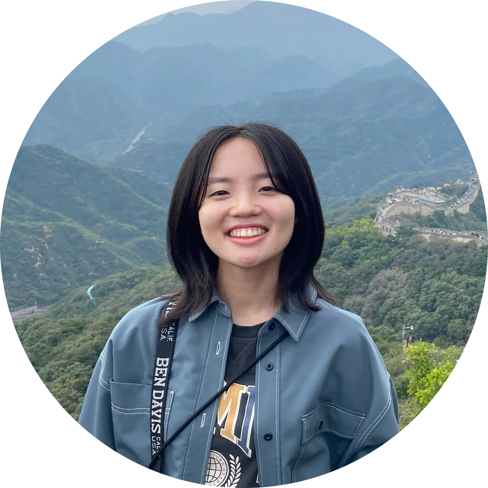
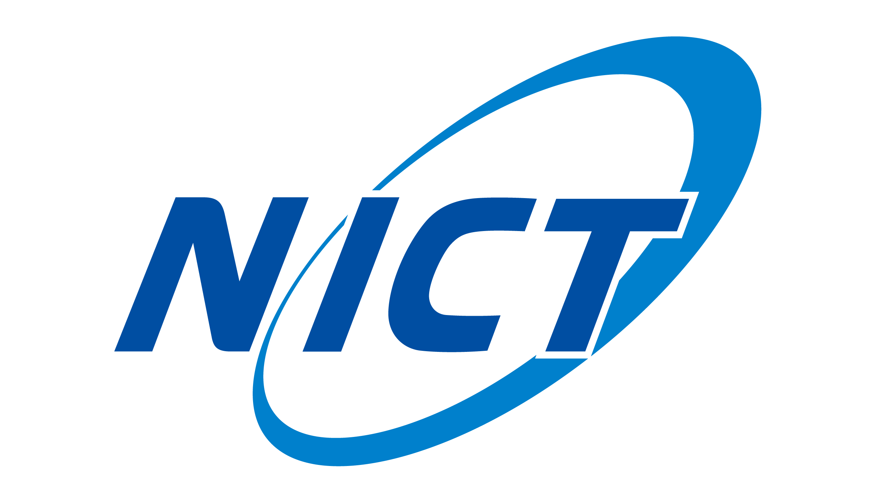
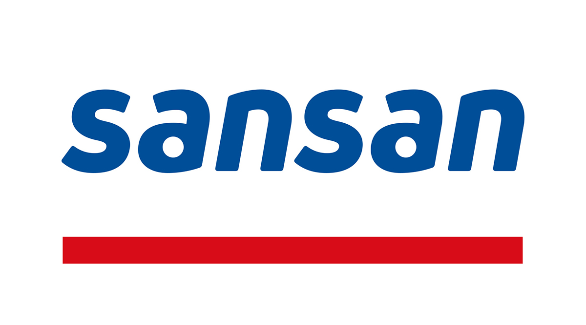

<nav class="side-nav">
  <a href="#profile">Profile</a>
  <a href="#news">News</a>
  <a href="#publications">Publications</a>
  <a href="#education">Education</a>
  <a href="#experience">Work Experience</a>
  <a href="#awards">Awards</a>
  <a href="#funding">Funding</a>
  <a href="#skills">Skills</a>
  <a href="#hobbies">Hobbies</a>
  <a href="#contact">Contact</a>
</nav>

En/[Ja](index_ja.html)

  

  

    <h1>Yui Tatsumi</h1>
    

      <a href="https://github.com/qwert-top"><strong>Github</strong></a>　/　
      <a href="http://linkedin.com/in/qwert-top"><strong>Linkedin</strong></a>　/　
      <a href="https://scholar.google.com/citations?user=u1nK1wgAAAAJ"><strong>Google Scholar</strong></a>
    

    
<strong>Hi! I’m Yui Tatsumi, a Master’s student in Computer Science at Waseda University, Japan.</strong>

    

      My research interests include Artificial Intelligence, Computer Vision, and Signal Processing.
      Under the supervision of Professor Hiroshi Watanabe, my reseach primarily focuses on
      Neural Network-based Image Compression for Humans and Machines.
    

    

      Upon graduating from my undergraduate program, I received a departmental award for ranking in the top 5% of my department based on academic performance and research achievements.
    

    

      After completing my master’s program in Spring 2027, I plan to pursue a research position in industry.
    

  

  <h2 id="news" class="section-heading">📰News</h2>

  

    

      2026.09.25
      Our paper was accepted to <strong>NeurIPS 2026</strong>.
    

    

      2026.09.15
      Our paper was accepted to <strong>IEEE VCIP 2026</strong>.
    

    

      2026.08.06
      I received the <strong>MIRU 2026 Interactive Presentation Award</strong>.
    

  

<h2 id="publications" class="section-heading">📚PUBLICATIONS</h2>

## Preprints

## Peer-Reviewed Journal Papers

1. Takahiro Shindo, Taiju Watanabe, <u>Yui Tatsumi</u>, Hiroshi Watanabe, “**Image Coding for Object Recognition Tasks Based on Contour Feature Learning with Flexible Object Selection,**” **IEEE Access**, 2025.
   

## International Conference

1. <u>Yui Tatsumi</u>, Hiroshi Watanabe, “**Scalable Variable-Rate Video Compression for Humans and Machines via Keyframe Interpolation**,” International Workshop on Advanced Image Technology (**IWAIT**), 2027. (to appear)
1. Ananthiya Chanchotsathien, <u>Yui Tatsumi</u>, Hiroshi Watanabe, “**Hierarchical Vision MLP: A Simple Local Aggregation Model for Efficient Image Classification,**” International Workshop on Advanced Image Technology (**IWAIT**), 2027. (to appear)
1. <u>Yui Tatsumi</u>, Hiroshi Watanabe, "**Generalizable Variable-Rate Adaptation for Image Coding for Machines,**" IEEE International Conference on Visual Communications and Image Processing (**VCIP**), 2026. (to appear)
1. Ziyue Zeng, Xun Su, Haoyuan Liu, Bingyu Lu, <u>Yui Tatsumi</u>, Hiroshi Watanabe, “**GVCC: Zero-Shot Video Compression via Codebook-Driven Stochastic Rectified Flow,**” The Fortieth Annual Conference on Neural Information Processing Systems (**NeurIPS**), 2026. (to appear)
   
1. <u>Yui Tatsumi</u>, Hiroshi Watanabe, “**Training-Free Continuous Bitrate Control for Scalable Image Coding for Humans and Machines,**” IEEE 15th Global Conference on Consumer Electronics (**GCCE**), 2026. (to appear)
   
1. Ziyue Zeng, <u>Yui Tatsumi</u>, Hiroshi Watanabe, “**Flow Residual Segmentation and Generative Reconstruction for Motion-Aware Video Coding,**” The 9th IIEEJ International Conference on Image Electronics and Visual Computing (**IEVC**), 2026.
   
1. <u>Yui Tatsumi</u>, Ziyue Zeng, Hiroshi Watanabe, “**Training-Free Adaptive Quantization for Variable Rate Image Coding for Machines,**” IEEE 44th International Conference on Consumer Electronics (**ICCE**), 2026.
   
   
   
1. Taiju Watanabe, Takahiro Shindo, <u>Yui Tatsumi</u>, Hiroshi Watanabe, “**VFI-LoRA: Leveraging Video Diffusion Models for Video Interpolation Through LoRA Finetuning,**” IEEE International Conference on Internet of Things and Intelligence System (**IoTaIS**), 2025.
   
1. <u>Yui Tatsumi</u>, Ziyue Zeng, Hiroshi Watanabe, “**Seed Selection for Human-Oriented Image Reconstruction via Guided Diffusion,**” IEEE 14th Global Conference on Consumer Electronics (**GCCE**), 2025.
   
   
1. Ziyue Zeng, <u>Yui Tatsumi</u>, Hiroshi Watanabe, “**Bidirectional Attention-Gated Motion Injection for Frame Interpolation,**” IEEE 14th Global Conference on Consumer Electronics (**GCCE**), 2025.
   
1. <u>Yui Tatsumi</u>, Ziyue Zeng, Hiroshi Watanabe, “**Explicit Residual-Based Scalable Image Coding for Humans and Machines,**” IEEE 27th International Workshop on Multimedia Signal Processing (**MMSP**), 2025.
   
   
1. Takahiro Shindo, <u>Yui Tatsumi</u>, Taiju Watanabe, Hiroshi Watanabe, “**Guided Diffusion for the Extension of Machine Vision to Human Visual Perception,**” IEEE 27th International Workshop on Multimedia Signal Processing (**MMSP**), 2025.
   
   
1. Takahiro Shindo, Taiju Watanabe, <u>Yui Tatsumi</u>, Hiroshi Watanabe, “**Delta-ICM: Entropy Modeling with Delta Function for Learned Image Compression,**” IEEE 43rd International Conference on Consumer Electronics (**ICCE**), 2025.
   
   
1. <u>Yui Tatsumi</u>, Shoko Tanaka, Shunsuke Akamatsu, Takahiro Shindo, Hiroshi Watanabe, “**Classification in Japanese Sign Language Based on Dynamic Facial Expressions,**” IEEE 13th Global Conference on Consumer Electronics (**GCCE**), 2024.
   
   
1. Shoko Tanaka, <u>Yui Tatsumi</u>, Takahiro Shindo, Hiroshi Watanabe, “**Integrating QR Code Characteristics Into Super-Resolution Method,**” IEEE 13th Global Conference on Consumer Electronics (**GCCE**), 2024.
   
1. Takahiro Shindo, <u>Yui Tatsumi</u>, Taiju Watanabe, Hiroshi Watanabe, “**Refining Coded Image in Human Vision Layer Using CNN-Based Post-Processing,**” IEEE 13th Global Conference on Consumer Electronics (**GCCE**), 2024.
   
   
1. Takahiro Shindo, Taiju Watanabe, <u>Yui Tatsumi</u>, Hiroshi Watanabe, “**Scalable Image Coding for Humans and Machines Using Feature Fusion Network,**” IEEE 26th International Workshop on Multimedia Signal Processing (**MMSP**), 2024.
   
   
   

## Domestic Conference, Japan

1. <u>Yui Tatsumi</u>, Hiroshi Watanabe, “**Generalizable Variable-Rate Adaptation for Image Coding for Machines via Importance-Adaptive Quantization and Knowledge Distillation (in Japanese)**,” Picture Coding Symposium of Japan (PCSJ), 2026.
1. Rikito Fukuhara, <u>Yui Tatsumi</u>, Hiroshi Watanabe, “**Quantitative Evaluation of Text Degradation in Generative Image Compression and a Study on Text Preservation Methods (in Japanese)**,” Picture Coding Symposium of Japan (PCSJ), 2026.
1. Haruya Yamaguchi, <u>Yui Tatsumi</u>, Hiroshi Watanabe, “**A Study on Performance Improvement of Learned Image Compression Based on Local Degradation Prediction (in Japanese)**,” Picture Coding Symposium of Japan (PCSJ), 2026.
1. <u>Yui Tatsumi</u>, Ziyue Zeng, Hiroshi Watanabe, “**Scalable Variable-Rate Video Compression for Humans and Machines via Keyframe Interpolation (in Japanese),**” The 29th Meeting on Image Recognition and Understanding (MIRU), 2026.
1. <u>Yui Tatsumi</u>, Ziyue Zeng, Hiroshi Watanabe, “**Assessing the Effectiveness of Residual Information in Scalable Image Coding for Humans and Machines (in Japanese),**” The 28th Meeting on Image Recognition and Understanding (MIRU), 2025.
1. Takahiro Shindo, Taiju Watanabe, <u>Yui Tatsumi</u>, Hiroshi Watanabe, “**Evaluation of Face Recognition Accuracy in Decoded Images for Machine Vision (in Japanese),**” The 87th National Convention of IPSJ, 2025.
1. Taiju Watanabe, Takahiro Shindo, <u>Yui Tatsumi</u>, Hiroshi Watanabe, “**Video Frame Interpolation Using Pretrained Diffusion Model (in Japanese),**” The 87th National Convention of IPSJ, 2025.
1. <u>Yui Tatsumi</u>, Takahiro Shindo, Taiju Watanabe, Hiroshi Watanabe, “**Scalable Image Coding for Humans and Machines Using Feature Differences (in Japanese),**” Picture Coding Symposium of Japan (PCSJ), 2024.
1. Takahiro Shindo, Taiju Watanabe, <u>Yui Tatsumi</u>, Hiroshi Watanabe, “**Assessing the Effectiveness of ICM Method for Privacy Protection (in Japanese),**” Picture Coding Symposium of Japan (PCSJ), 2024.
1. Taiju Watanabe, Takahiro Shindo, <u>Yui Tatsumi</u>, Hiroshi Watanabe, “**A Method for Video Frame Interpolation Using Cross-Frame Attention (in Japanese),**” ITE Annual Convention, 2024.

<h2 id="education" class="section-heading">🏫EDUCATION</h2>

  

    
Apr. 2025 - Present

    

      
    

    

      <h3>Master of Engineering</h3>
      
<strong>Department of Computer Science and Communications Engineering, <a href="https://www.waseda.jp/top/en/">Waseda University</a></strong>

      
Supervisor: Prof. <a href="https://www.ams.giti.waseda.ac.jp/">Hiroshi Watanabe</a>

      
Topics: Image Compression for Humans/Machines

      <ul>
        <li>Conducted NICT commissioned research as a Research Assistant.</li>
        <li>Relevant Coursework: Advanced Image Information, Natural Language Processing, Information Security, Software Decelopment, and more. </li>
      </ul>
    

  

  

    
Apr. 2021 - Mar. 2025

    

      
    

    

      <h3>Bachelor of Engineering</h3>
      
<strong>Department of Communications and Computer Engineering, <a href="https://www.waseda.jp/top/en/">Waseda University</a></strong>

      
GPA: 3.6/4.0 <strong>(top 5%)</strong>

      
Supervisor: Prof. <a href="https://www.ams.giti.waseda.ac.jp/">Hiroshi Watanabe</a>

      
Topics: Image Compression for Humans/Machines, Sign Language Recognition

      <ul>
        <li>Conducted NICT commissioned research as a Research Support Staff.</li>
        <li>Relevant Coursework: Computer Programming, Multimedia Systems, Software Engineering, Computer Architecture, Information Theory, Operating System, Signal Processing, and more.</li>
        <li>Published papers at international and domestic conferences such as <em>IEEE GCCE 2024</em> and <em>PCSJ/IMPS 2024</em>.</li>
      </ul>
    

  

  

    
Sep. 2018 - Mar. 2021

    

      
    

    

      <h3>International Christian University High School</h3>
      
GPA: 4.8/5.0

    

  

  

    
Oct. 2015 - Jun. 2018

    

      
HI

    

    

      <h3>Public School in Hawaii, U.S.</h3>
    

  

<h2 id="experience" class="section-heading">👔WORK EXPERIENCE</h2>

  

    
Apr. 2026 - Present

    

      
    

    

      <h3>Learning Assistant</h3>
      
Waseda University

      <ul>
        <li>Supporting undergraduate students in programming (Python, Java, C/C++) and information science courses by answering questions, providing feedback on assignments, and helping them understand fundamental programming concepts.</li>
      </ul>
    

  

   

    
Apr. 2024 - Mar. 2026

    

      
    

    

      <h3>Commissioned Research Assistant</h3>
      
National Institute of Information and Communications Technology (NICT)

      <ul>
        <li>Led a research project (Grant No. 05101) commissioned by NICT.</li>
        <li>Worked on research projects such as Image Coding for Machines, Scalable Image Coding for Humans and Machines and Video Frame Interpolation.</li>
        <li>Published one journal paper and eleven international conference papers (IEEE MMSP 2025, IEEE ICCE 2025, etc.) as a commissioned research team from Waseda University.</li>
      </ul>
    

  

  

    
Jan. 2026

    

      
    

    

      <h3>Research Intern</h3>
      
Hitachi, Central Research Laboratory

      <ul>
        <li>Conducted research on reliability enhancement and self-evolution technologies for AI agents.</li>
      </ul>
    

  

 

    
Oct. 2025

    

      
    

    

      <h3>Teaching Assistant</h3>
      
Waseda University

      <ul>
        <li>Assisted students with hands-on exercises in deep learning for image recognition, covering network architectures, training mechanisms, and image processing.</li>
      </ul>
    

  

  

    
Aug. 2025 - Nov. 2025

    

      
    

    

      <h3>Research Intern</h3>
      
IBM Research - Tokyo

      <ul>
        <li>Conducted research and investigation on AI agents for compliance automation.</li>
      </ul>
    

  

  

    
Aug. 2025 - Sep. 2025

    

      
    

    

      <h3>Research Intern</h3>
      
Sansan

      <ul>
        <li>Conducted R&amp;D on business card digitization, focusing on improving the performance and automation rate of Viola, an in-house VLM developed at Sansan.</li>
      </ul>
    

  

<h2 id="awards" class="section-heading">🏆ACADEMIC AWARDS</h2>

1. <a href="https://miru-committee.github.io/miru2026/en/author/award/">MIRU Interactive Presentation Award</a>, MIRU 2026 (2026)
2. <a href="https://www.ieee-gcce.org/2025/awards.html">Oral Presentation Award</a>, IEEE GCCE 2025 (2025)
3. Dean's award for students who have achieved excellence in research activities during their undergraduate years, **TOP 5%** in the Department of Communications and Computer Engineering, Waseda University (2025)
4. <a href="https://www.ieee-gcce.org/2024/presentationawards.html">Oral Presentation Award</a>, IEEE GCCE 2024 (2024)

<h2 id="funding" class="section-heading">💰RESEARCH FUNDING</h2>

- NICT (National Institute of Information and Communications Technology) - No.05101 "R&D on ultra-coverage Beyond 5G wireless communication and video coding standardization technologies through international collaboration (Japan-US-Australia)"

<h2 id="skills" class="section-heading">✨SKILLS</h2>

- Programming Language: Python / C / Java / JavaScript
- Frameworks and Application Tools: PyTorch, OpenCV
- Others: GitHub / Docker / Kubernetes
- Natural Language: Japanese (Native), English, Japanese Sign Language

<h2 id="hobbies" class="section-heading">💚HOBBIES</h2>

Traveling / Japanese Sign Language / Movies

<h2 id="contact" class="section-heading">✉️CONTACT</h2>

Email: **yui.t@fuji.waseda.jp**
